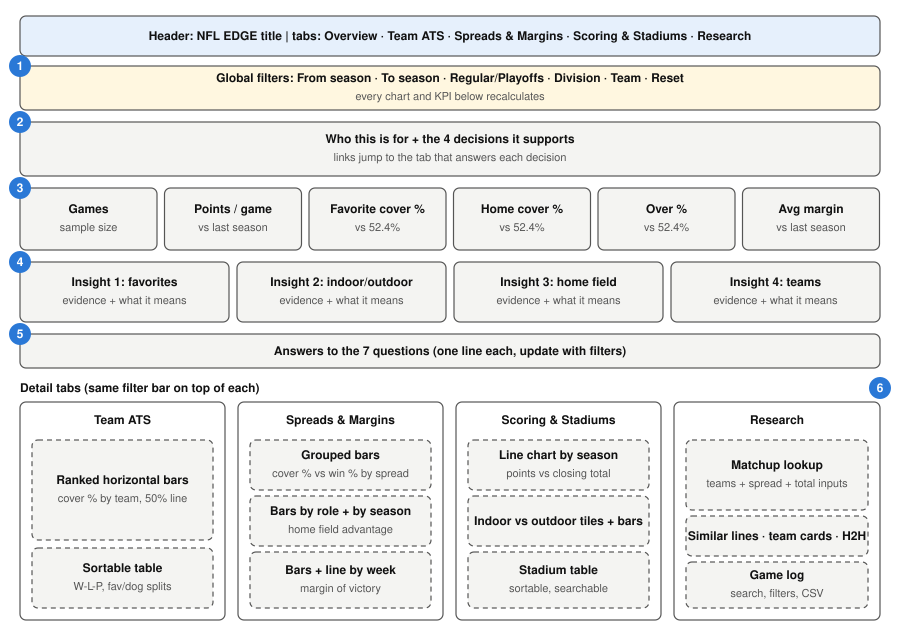

# NFL EDGE dashboard: plan, definitions and verification

Live file: `dashboard/nfl_dashboard.html` (built by `scripts/build_dashboard.py` from `data/raw/games.csv`).
Data: nflverse `games.csv`, completed games from the 2020 season onward (1,829 games through 2026-11-09 at the time of writing).

## 1. Intended user and decisions

**User:** NFL bettors, new or experienced, who want to see historical trends in results against the betting line before placing a point-spread or over/under bet. Novices get a plain-language glossary and one-sentence answers; experienced bettors get the splits, sample sizes and tables underneath.

| # | Decision | Where it is answered |
|---|---|---|
| 1 | Should I back the favorite or the underdog at this spread? | The Spread |
| 2 | Should I bet the over or the under, given the stadium and the total? | Totals |
| 3 | How close should I expect this kind of game to be? | Margins |
| 4 | How have these two teams and similar lines done in this exact spot? | Research |

### Question framework

The dashboard is organised as an inverted pyramid. Each section opens with one broad question, then the questions that explain it, then the detailed breakdowns. Every question shows a one-sentence answer that recalculates with the filters; the evidence (chart or table) sits underneath and opens on click. Level 1 and 2 are open by default, level 3 is closed.

The seven original questions were reworded and regrouped. The number in brackets is the original question each one came from.

**The spread**

| Level | Question | Evidence |
|---|---|---|
| 1 Big picture | Does either side of the spread win more often than it should? [7] | Cover % for favorites, underdogs, home and away teams against 50% and the 52.4% break-even |
| 2 Driver | Does a bigger spread make the favorite more or less likely to cover? [5] | Favorite cover % and win % by spread bucket |
| 2 Driver | How much is home field worth, and is it already in the line? [7] | One chart: average home margin vs. the average home spread, by season |
| 3 Detail | Which teams have covered most and least often, as favorites and as underdogs? [1] | Ranked team chart with all / favorite / underdog switch; sortable team table |
| 3 Detail | How have favorites done at each exact spread? [5] | Table with one row per closing spread |

**Totals**

| Level | Question | Evidence |
|---|---|---|
| 1 Big picture | Is NFL scoring rising or falling, and do the totals keep pace? [4] | Points per game vs. average closing total by season |
| 2 Driver | Do indoor games produce more points, and more overs, than outdoor games? [2] | Indoor vs. outdoor comparison; points and totals by roof type |
| 2 Driver | Do high totals go over more or less often than low ones? [2, 4] | Over % by size of the closing total |
| 3 Detail | Which stadiums play over or under their totals? [2] | Sortable, searchable stadium table |
| 3 Detail | Which teams' games are the highest and lowest scoring? [4] | Team scoring table with over % |

**Margin of victory**

| Level | Question | Evidence |
|---|---|---|
| 1 Big picture | How close is a typical NFL game? [3, 6] | Distribution of final margins, with 3 and 7 highlighted |
| 2 Driver | Are divisional, prime-time and playoff games closer than the rest? [3] | Average margin by game type |
| 2 Driver | Do games get closer or more lopsided as the season goes on? [6] | Average margin by week and playoff round |
| 3 Detail | How do one-score games and blowouts split by game type? [3] | Table of margin, median, one-score %, blowout % by game type |
| 3 Detail | Does the early-to-late pattern hold in every season? [6] | Season by part-of-season table |

What changed from the original wording: question 7 ("home teams or favorites") became the opening question for the spread, since it asks whether anyone has an edge at all; questions 5 and 1 explain and detail it. Questions 3 and 6 both concerned margin of victory, so they share one section under a new opening question about how close games are. Sub-points such as "specific stadiums" and "as favorites and as underdogs" became level 3 questions of their own.

## 2. Sketch: key charts, filters and reading order

Reading order: (1) set filters, (2) confirm who the page is for and pick a decision, (3) read the six headline KPIs with their benchmarks, (4) pick one of the three opening questions and read its answer, (5) read the four takeaways, (6) open the question's tab and work down from the big picture to the drivers to the detail.

## 3. KPI definitions

All KPIs are computed over the games left after the filters are applied. Only completed games are included.

| KPI | Formula | Unit | Aggregation | Exclusions |
|---|---|---|---|---|
| Games | Count of completed games | games | count | Unplayed games |
| Points per game | (home score + away score) summed ÷ games | points per game | mean per game | none |
| Favorite cover % | favorite covers ÷ (covers + non-covers); a cover = favorite's winning margin > closing spread | % | ratio of counts | Pushes (margin = spread) left out of the denominator and reported in the W-L-P record; games with no favorite |
| Home cover % | home covers ÷ (covers + non-covers); a cover = (home score − away score) > home closing spread | % | ratio of counts | Pushes; neutral-site games |
| Over % | overs ÷ (overs + unders); over = combined points > closing total | % | ratio of counts | Pushes (combined points = total) |
| Avg margin of victory | mean of \|home score − away score\| | points | mean per game | none (ties count as 0) |
| Home win % (The Spread) | home wins ÷ games | % | ratio of counts | Neutral-site games; ties count as games, not wins |
| Home-field advantage (The Spread) | mean of (home score − away score) | points | mean per game | Neutral-site games |

Supporting definitions: favorite = side favored by the closing spread (moneyline breaks a pick'em); indoor = dome or retractable roof closed; prime time = kickoff 7:00 PM ET or later; divisional = both teams in the same division.

## 4. Context for the metrics

| Comparison | Applied to | Why |
|---|---|---|
| **Target: 52.4% break-even** (win rate needed at −110 odds) | Favorite cover %, Home cover %, Over %, every rate on the Research tab | A cover rate only matters to a bettor if it clears the cost of betting |
| **Benchmark: league baseline** (all teams, all seasons, same regular/playoff setting) | Every KPI, shown whenever a filter narrows the games | Shows whether a team, division or season is unusual |
| **Previous period: prior season** | Points per game, Avg margin of victory | Shows the direction of the trend |
| **50% reference line** | All cover % and over % charts | Coin-flip baseline |
| **Chance test ("could be chance" / "more than chance")** | Every answer line that compares two groups, team and spread tables, chart hovers, Research and Compare | Separates real differences from noise; small samples fail the test on their own |
| **Sample size (n, W-L-P)** | Charts, tables, Research tab | Shows how much data sits behind each rate |

## 5. Required features

| Requirement | How it is met |
|---|---|
| ≥ 4 labeled KPIs with units and context | 6 on Overview with benchmark lines; 5 more on each of The Spread, Totals and Margins |
| ≥ 4 different, purposeful visualizations | Horizontal bars (cover % by side, by team), grouped bars (cover % vs. win % by spread), line charts (points vs. total by season; margin by week), histogram (final margins), category bars (roof, total size, game type), comparison tiles (indoor vs. outdoor), sortable tables (teams, exact spreads, stadiums, team scoring, game types, seasons, game log) |
| Comparing teams, seasons and outcomes (instructor feedback) | Research → Compare puts two teams or two periods side by side, with the difference and a chance test on each row |
| ≥ 2 filters that recalculate charts and KPIs | 5 global filters (from season, to season, regular/playoffs, division, team) plus per-section controls (favorite/underdog switch, min games, search, outcome filters, matchup inputs) |
| Visual design | "?" hints define each metric where it appears; one filter bar; one tab per question; the same three-level layout on every question tab; three series colors with fixed meaning; light and dark themes |
| ≥ 3 evidence-based insights | 4 on the Overview, each with the numbers and a "what it means" implication (section 6) |
| Accuracy check | 19 values checked independently, including 3 filter combinations (section 7) |

## 6. Insights and implications (all games, 2020–2026)

1. **Bigger favorites win more, but they do not cover more.** Outright win rate rises from 53% (pick'em to 2.5) to 92% (14+), while cover rate stays between 44% and 52% in every bucket; overall favorites cover 48.5% (868-922-39). *Implication:* betting favorites blindly loses money, and a likely winner is not a likely cover.
2. **Indoor games score more, and the line already knows it.** Indoor games average 48.4 points vs. 44.7 outdoors, but indoor totals are also set higher (46.6 vs. 44.6). Over hits 51.7% indoors and 47.8% outdoors. *Implication:* neither side of the split reaches 52.4%; the roof alone is not a reason to bet a total.
3. **Home-field advantage is real, and fully priced in.** Home teams win 53.5% of games by 1.8 points on average, yet cover only 49.3% (862-886-38). *Implication:* do not add points for home field; the spread has done it.
4. **The widest gaps are between teams.** Detroit has covered 60.0% (66-44-3) and the Jets 39.8% (43-65-2); 8 of 32 teams are above break-even. *Implication:* team history separates sides more than situation does, but check splits and sample size, since streaks fade as the market adjusts.

## 7. Accuracy and reliability

`scripts/verify_dashboard.py` recomputes values straight from the CSV with plain pandas. It shares no code with the dashboard (which computes in JavaScript) or with `nfl_edge/cleaning.py`. Values were then read off the rendered dashboard in a browser and compared (data through 2026-11-09).

| # | Displayed value | Filters | Dashboard | Independent | Match |
|---|---|---|---|---|---|
| 1 | Games | none | 1,829 | 1829 | ✔ |
| 2 | Points per game | none | 45.9 | 45.9 | ✔ |
| 3 | Favorite cover % | none | 48.5% (868-922-39) | 48.5 (868-922-39) | ✔ |
| 4 | Home cover % | none | 49.3% (862-886-38) | 49.3 (862-886-38) | ✔ |
| 5 | Over % | none | 49.0% (888-923-18) | 49.0 (888-923-18) | ✔ |
| 6 | Avg margin of victory | none | 11.1 | 11.1 | ✔ |
| 7 | Home win % | none | 53.5% | 53.5 | ✔ |
| 8 | DET cover % (The Spread, team table) | none | 60.0% (66-44-3) | 60.0 (66-44-3) | ✔ |
| 9 | Indoor avg points | none | 48.4 | 48.4 | ✔ |
| 10 | Outdoor avg points | none | 44.7 | 44.7 | ✔ |
| 11 | Favorites laying exactly 3 (Research) | none | 49.2% (121-125-23) | 49.2 (121-125-23) | ✔ |
| 12 | Games | 2023–2024 · regular season · AFC North | 112 | 112 | ✔ |
| 13 | Favorite cover % | same | 58.3% (63-45-4) | 58.3 (63-45-4) | ✔ |
| 14 | Points per game | same | 45.0 | 45.0 | ✔ |
| 15 | Games | playoffs · team KC | 16 | 16 | ✔ |
| 16 | Over % | same | 46.7% (7-8-1) | 46.7 (7-8-1) | ✔ |
| 17 | Games | 2025 only | 285 | 285 | ✔ |
| 18 | Home cover % | same | 50.7% (140-136-1) | 50.7 (140-136-1) | ✔ |
| 19 | Avg margin of victory | same | 11.1 | 11.1 | ✔ |

Chance labels were also re-derived by hand from the same counts (z-scores, 95% level = 1.96):

| Comparison | Independent z | Dashboard label | Match |
|---|---|---|---|
| Underdog cover % vs. 50% (922-868) | 1.28 | could be chance | ✔ |
| Indoor vs. outdoor points per game | 5.37 | more than chance | ✔ |
| Early (weeks 1–6) vs. late (13–18) margin | 1.78 | could be chance | ✔ |
| Favorite cover %, 2020–22 vs. 2023–26 (Compare) | −2.43 | more than chance | ✔ |

Filter behaviour also checked: Reset returns to 1,829 games; choosing a "from" season later than "to" moves the other end; a combination with no games (for example playoffs + NYJ) shows empty states instead of errors; every tab renders without script errors under each combination above.

### Limitations

- **Closing lines only.** One consensus closing spread and total per game; no opening lines, line movement or sportsbook-specific prices.
- **Break-even assumes −110** on both sides; actual prices vary.
- **Partial current season.** 2026 is in progress, so its season-level figures rest on fewer games.
- **Small samples.** Single seasons, playoffs, or one team in one role can be a handful of games; they are shown and labelled "could be chance".
- **Chance test.** A two-sided normal approximation at the 95% level. "Could be chance" means luck cannot be ruled out, not that no effect exists. Many groups are tested at once (32 teams, 38 spreads), so a few will pass by luck; the dashboard says so next to the team table.
- **Team and division filters keep games *involving* the team or division**, so league-wide KPIs under those filters include the opponents' side of each game. Team-by-team tables use the filters to choose and highlight teams instead.
- **Divisions use the current alignment**, which is correct for all seasons shown.
- **Descriptive, not predictive.** No model, no adjustment for injuries, weather or roster changes.
- **The hosted Claude link is a snapshot** and its CSV download is disabled; the GitHub Pages copy refreshes weekly.
